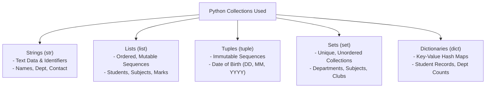
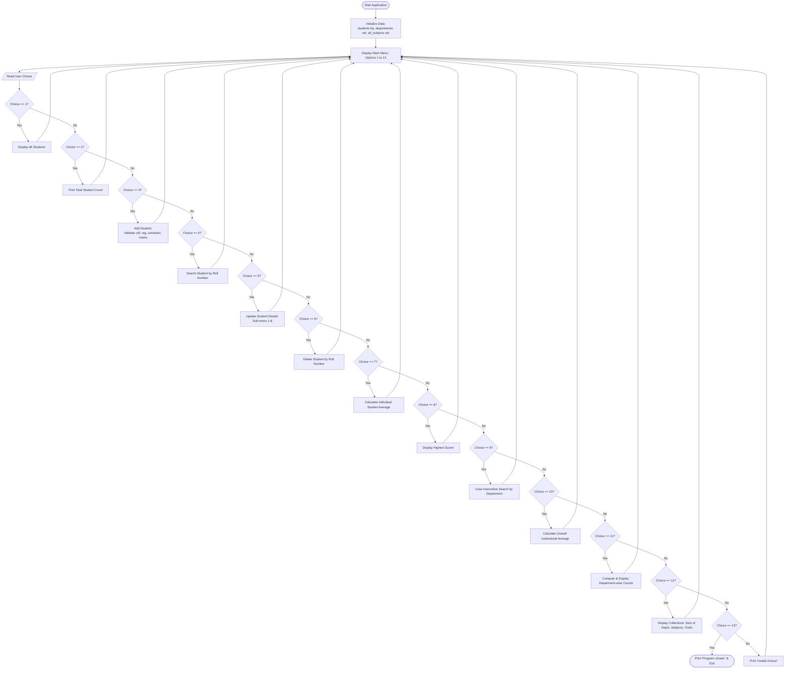

# Student Record and Academic Management System
## Data Organization and Management Using Python Collections

---

### Project Report & System Documentation

---

## 1. Project Title & Problem Statement

### 1.1 Project Title
**Student Record and Academic Management System: Data Organization and Management Using Python Collections**

### 1.2 Problem Statement
In educational institutions, managing student academic records—including personal identification, enrollment data, subject marks, attendance percentages, and club participations—requires structured organization and efficient retrieval. Traditional manual record-keeping methods are prone to typographical inconsistencies, record loss, and tedious search overhead. 

This project addresses the problem by designing a robust, interactive, menu-driven Python application that organizes academic data entirely in memory using standard Python collection types (**Strings, Lists, Tuples, Sets, and Dictionaries**). The system facilitates record addition, real-time searching, updates, deletions, aggregate academic calculations, and frequency reporting without requiring external database engines or heavyweight dependencies.

---

## 2. Objectives

The primary educational and technical objectives of this project are:
1. **Practical Application of Python Collections**: Demonstrate how core Python collections (strings, lists, tuples, sets, and dictionaries) operate in real-world academic data modeling.
2. **Menu-Driven Architecture**: Provide an intuitive command-line interface (CLI) allowing users to execute 13 distinct academic operations seamlessly in a continuous loop.
3. **Data Integrity & Validation**:
   - Prevent duplicate Roll Numbers and duplicate Registration Numbers.
   - Enforce numeric range validation on Semesters ($1 \le \text{Semester} \le 8$), Subject counts ($1 \le N \le 10$), Marks ($0 \le \text{Mark} \le 100$), and Attendance ($0 \le \text{Attendance} \le 100$).
   - Prevent division by zero when calculating averages for empty subject lists.
   - Ensure case-insensitive comparisons for department queries and registration codes.
4. **Adherence to First-Year Syllabus**: Maintain a procedural programming approach using basic functions, loops, conditional constructs, and exception handling without introducing object-oriented classes, persistent databases, external modules, or complex frameworks.

---

## 3. Scope and Limitations

### 3.1 Scope
- **Interactive In-Memory CRUD Operations**: Complete Create, Read, Update, and Delete operations for student academic records during runtime.
- **Statistical Analytics**:
  - Individual student total marks and percentage average.
  - Identification of the highest-scoring student.
  - Overall aggregate institutional average across all subject entries.
  - Department-wise student distribution counts.
- **Input Sanitization**: Basic validation for non-empty text, numeric conversion error handling using `try...except ValueError`, and bounded range checks.
- **Self-Contained Execution**: Runs cleanly on any standard Python 3.x environment without external package dependencies.

### 3.2 Limitations
- **Volatile Storage**: The system maintains records in volatile memory (RAM). When the program exits, all modifications or newly added records reset to the initial sample state upon restart. (File handling and databases are intentionally excluded per syllabus restrictions).
- **Console Interface**: Operates via text-based terminal inputs rather than a graphical user interface (GUI) or web interface.
- **Single-User Session**: Designed for local, single-user operation; does not support concurrent network access or multi-threading.

---

## 4. Data Structures Used and Selection Rationale

The project models academic entities using five primary Python collection types, selecting each based on its operational characteristics:



### 4.1 Strings (`str`)
- **Characteristics**: Immutable sequence of characters.
- **Usage**: Storing student names (`name`), registration numbers (`registration_no`), department titles (`department`), email addresses (`email`), contact numbers (`phone`), and addresses (`address`).
- **Rationale**: Strings provide rich built-in manipulation methods such as `.strip()` (to remove extraneous leading/trailing whitespace) and `.casefold()` (to enable case-insensitive equality checks for department searches and registration numbers).

### 4.2 Lists (`list`)
- **Characteristics**: Ordered, mutable sequence allowing indexed access and dynamic modification.
- **Usage**:
  - `students`: The master list containing all student dictionary records.
  - `s["subjects"]`: List of strings representing enrolled courses.
  - `s["marks"]`: List of floating-point numbers representing scores.
  - `s["attendance"]`: List of floating-point numbers representing attendance percentages.
- **Rationale**: Lists preserve the order of elements, enabling parallel indexing across subjects, marks, and attendance. For instance, if subject index 0 is `"Python"`, marks index 0 corresponds to the Python score, and attendance index 0 corresponds to Python attendance. Methods like `.append()`, `.remove()`, `sum()`, and `len()` facilitate dynamic updates.

### 4.3 Tuples (`tuple`)
- **Characteristics**: Ordered, immutable sequence of elements.
- **Usage**: Storing fixed demographic data such as Date of Birth `(day, month, year)` in initial demonstration records (e.g., `(15, 8, 2007)`).
- **Rationale**: Demographic attributes like a birth date are intrinsically constant. Tuples provide structural integrity by preventing accidental runtime mutations.

### 4.4 Sets (`set`)
- **Characteristics**: Unordered collection of unique, hashable elements.
- **Usage**:
  - `departments`: Set of unique department names across the college.
  - `all_subjects`: Set of unique subjects offered across all students.
  - `s["clubs"]`: Set of extracurricular student clubs joined by an individual student.
- **Rationale**: Sets automatically eliminate duplicate entries. When students enter subjects or departments, `.add()` ensures that duplicates are naturally discarded. The `show_collections()` operation leverages `.update()` to compute the union of all active student clubs.

### 4.5 Dictionaries (`dict`)
- **Characteristics**: Unordered, mutable key-value mapping offering $O(1)$ average time complexity for key lookups.
- **Usage**:
  - Individual student records: Each student is represented as a dictionary mapping semantic field names (`"roll_no"`, `"name"`, `"department"`, etc.) to their respective data values.
  - `department_count`: A dynamic dictionary mapping each department name to the integer count of enrolled students.
- **Rationale**: Dictionaries provide named access to attributes without having to remember positional integer indexes, making the code readable and easy to explain.

---

## 5. System Architecture & Algorithms

### 5.1 Main Application Loop Algorithm
```text
Step 1: Initialize global data structures:
        - Populate 'students' list with sample student dictionaries.
        - Populate 'departments' set with known departments.
        - Populate 'all_subjects' set with known courses.
Step 2: Start an infinite loop (while True).
Step 3: Display the main menu with options 1 through 13.
Step 4: Prompt user for 'choice'.
Step 5: Match 'choice':
        Case '1'  : Call display_students()
        Case '2'  : Call count_students()
        Case '3'  : Call add_student()
        Case '4'  : Call search_student()
        Case '5'  : Call update_student()
        Case '6'  : Call delete_student()
        Case '7'  : Call calculate_average()
        Case '8'  : Call highest_scorer()
        Case '9'  : Call search_by_department()
        Case '10' : Call overall_average()
        Case '11' : Call department_counts()
        Case '12' : Call show_collections()
        Case '13' : Print exit message and terminate loop (break)
        Default   : Display "Invalid choice!"
Step 6: Repeat from Step 2 until exit is chosen.
```

### 5.2 Key Algorithms

#### Algorithm: Add Student (`add_student`)
```text
Step 1: Prompt for roll_no as integer inside try block.
Step 2: Search existing students; if roll_no found, display error and return.
Step 3: Prompt for registration_no; if empty or duplicate (case-insensitive), display error and return.
Step 4: Prompt for name, department, semester.
Step 5: If name or department is blank, or semester not in 1..8, display error and return.
Step 6: Prompt for email, phone, address.
Step 7: Prompt for number_of_subjects (must be between 1 and 10).
Step 8: For each subject (1 to number_of_subjects):
        a. Prompt for subject name; validate non-empty.
        b. Prompt for mark; validate 0 <= mark <= 100.
        c. Prompt for attendance; validate 0 <= attendance <= 100.
        d. Append to temporary lists: subjects, marks, attendance.
Step 9: Construct student dictionary with empty dob () and empty clubs set().
Step 10: Append new student dictionary to students list.
Step 11: Add department to departments set; add each subject to all_subjects set.
Step 12: Print success message.
```

#### Algorithm: Search by Roll Number (`search_student`)
```text
Step 1: Prompt user for integer roll_no inside try block.
Step 2: Iterate through students list.
Step 3: If student["roll_no"] equals target roll_no, display all fields and return.
Step 4: If loop completes without match, display "Student not found!".
Step 5: If ValueError occurs, display "Roll number must be a number!".
```

#### Algorithm: Update Student (`update_student`)
```text
Step 1: Prompt user for target roll_no.
Step 2: Locate student record using find_student(roll_no). If None, display "Student not found!" and return.
Step 3: Display sub-menu of updateable fields (1: Name, 2: Department, ..., 7: Marks, 8: Attendance).
Step 4: Read sub-menu choice:
        - If choice is '1' (Name): Prompt for new name, validate non-empty, update student["name"].
        - If choice is '2' (Department): Prompt new department, validate non-empty, update and add to departments set.
        - If choice is '3' (Semester): Prompt integer, validate 1 <= semester <= 8, update student["semester"].
        - If choice is '7' (Marks): Prompt subject name; if not in student["subjects"], display "Subject not found!" and return;
          otherwise, get index = student["subjects"].index(subject), prompt new marks (0-100), validate, update student["marks"][index].
        - If choice is '8' (Attendance): Similar to marks, update student["attendance"][index].
        - Else: Handle invalid choice.
Step 5: Display update success message.
```

#### Algorithm: Highest Scorer (`highest_scorer`)
```text
Step 1: Initialize empty list 'scored_students'.
Step 2: For each student in students:
        If student["marks"] is not empty:
            average = sum(student["marks"]) / len(student["marks"])
            Append tuple (average, student) to scored_students.
Step 3: If scored_students is empty, display "No marks available!" and return.
Step 4: Find maximum entry using max(scored_students, key=lambda item: item[0]).
Step 5: Unpack highest average and student dictionary; print name, roll number, and average marks rounded to 2 decimal places.
```

#### Algorithm: Overall Average (`overall_average`)
```text
Step 1: Initialize total_marks = 0, total_subjects = 0.
Step 2: For each student in students:
        total_marks += sum(student["marks"])
        total_subjects += len(student["marks"])
Step 3: If total_subjects == 0, display "No marks available!" and return.
Step 4: Compute overall_avg = total_marks / total_subjects.
Step 5: Display total_marks, total_subjects, and round(overall_avg, 2).
```

#### Algorithm: Department-wise Count (`department_counts`)
```text
Step 1: Initialize empty dictionary 'department_count'.
Step 2: For each student in students:
        department = student["department"]
        If department in department_count:
            department_count[department] += 1
        Else:
            department_count[department] = 1
Step 3: If department_count is empty, display "No student records available!" and return.
Step 4: For each (department, count) in department_count.items():
        Display department and count.
```

---

## 6. Pseudocode

### 6.1 Main Menu Loop
```pascal
PROGRAM StudentManagementSystem
BEGIN
    WHILE True DO
        PRINT "\n========== STUDENT MANAGEMENT SYSTEM =========="
        PRINT "1. Display Students"
        PRINT "2. Count Students"
        PRINT "3. Add Student"
        PRINT "4. Search Student"
        PRINT "5. Update Student"
        PRINT "6. Delete Student"
        PRINT "7. Calculate Average Marks"
        PRINT "8. Show Highest Scorer"
        PRINT "9. Search by Department"
        PRINT "10. Overall Average"
        PRINT "11. Department-wise Count"
        PRINT "12. Show Collections"
        PRINT "13. Exit"
        
        READ choice
        
        IF choice == "1" THEN CALL display_students()
        ELSE IF choice == "2" THEN CALL count_students()
        ELSE IF choice == "3" THEN CALL add_student()
        ELSE IF choice == "4" THEN CALL search_student()
        ELSE IF choice == "5" THEN CALL update_student()
        ELSE IF choice == "6" THEN CALL delete_student()
        ELSE IF choice == "7" THEN CALL calculate_average()
        ELSE IF choice == "8" THEN CALL highest_scorer()
        ELSE IF choice == "9" THEN CALL search_by_department()
        ELSE IF choice == "10" THEN CALL overall_average()
        ELSE IF choice == "11" THEN CALL department_counts()
        ELSE IF choice == "12" THEN CALL show_collections()
        ELSE IF choice == "13" THEN
            PRINT "Program closed."
            BREAK
        ELSE
            PRINT "Invalid choice!"
        END IF
    END WHILE
END
```

### 6.2 Key Functions Pseudocode
```pascal
FUNCTION find_student(roll_no)
    FOR EACH s IN students DO
        IF s["roll_no"] == roll_no THEN
            RETURN s
        END IF
    END FOR
    RETURN None
END FUNCTION

FUNCTION calculate_average()
    TRY
        READ roll_no AS integer
        s = find_student(roll_no)
        IF s == None THEN
            PRINT "Student not found!"
            RETURN
        END IF
        IF s["marks"] IS EMPTY THEN
            PRINT "No marks available!"
            RETURN
        END IF
        total = SUM(s["marks"])
        avg = total / LENGTH(s["marks"])
        PRINT "Student name:", s["name"]
        PRINT "Total marks:", total
        PRINT "Average marks:", ROUND(avg, 2)
    EXCEPT ValueError
        PRINT "Roll number must be a number!"
    END TRY
END FUNCTION
```

---

## 7. Flowcharts

### 7.1 Mermaid Flowchart of System Workflow


### 7.2 Text-Based Flowchart
```text
[START]
   │
   ▼
[Initialize Global Collections: students list, departments set, all_subjects set]
   │
   ▼
┌──► [DISPLAY MENU: Options 1 - 13]
│      │
│      ▼
│    [Read Choice]
│      │
│      ├─ 1  ──► [Display All Students] ──────────────────────────┐
│      ├─ 2  ──► [Print Total Student Count] ─────────────────────┤
│      ├─ 3  ──► [Prompt & Validate New Student Details] ─────────┤
│      ├─ 4  ──► [Search by Roll Number] ─────────────────────────┤
│      ├─ 5  ──► [Update Specific Field / Mark / Attendance] ─────┤
│      ├─ 6  ──► [Remove Student by Roll Number] ─────────────────┤
│      ├─ 7  ──► [Compute & Display Student's Average Marks] ─────┤
│      ├─ 8  ──► [Identify and Display Highest Scorer] ───────────┤
│      ├─ 9  ──► [Case-Insensitive Department Search] ────────────┤
│      ├─ 10 ──► [Compute Overall Institutional Average Marks] ───┤
│      ├─ 11 ──► [Aggregate Department-wise Counts (dict)] ───────┤
│      ├─ 12 ──► [Display Sets of Departments, Subjects, Clubs] ──┤
│      ├─ 13 ──► [Print "Program closed." & Terminate] ──► [END]  │
│      └─ Other► [Print "Invalid choice!"] ───────────────────────┤
│                                                                 │
└─────────────────────────────────────────────────────────────────┘
```

---

## 8. Verified Test Cases & Results

All test cases listed below were executed directly against `application/student_management.py` using Python 3.14.

| TC ID | Test Description | Input Provided | Expected Output | Actual Output | Status |
|:---:|---|---|---|---|:---:|
| **TC-01** | Display all initial students | Choice `1` | Displays records for Roll 101 and Roll 102 | Displayed full profiles for Rahul (101) & Priya (102) | **PASS** |
| **TC-02** | Count students | Choice `2` | `Total students: 2` | `Total students: 2` | **PASS** |
| **TC-03** | Search existing student | Choice `4`, Roll `101` | Displays complete record of Rahul | Record displayed accurately with all attributes | **PASS** |
| **TC-04** | Search non-existent student | Choice `4`, Roll `999` | `Student not found!` | `Student not found!` | **PASS** |
| **TC-05** | Search invalid roll data type | Choice `4`, Roll `abc` | `Roll number must be a number!` | `Roll number must be a number!` | **PASS** |
| **TC-06** | Calculate student average marks | Choice `7`, Roll `101` | Total: 253, Avg: 84.33 | `Total marks: 253`, `Average marks: 84.33` | **PASS** |
| **TC-07** | Individual average for missing roll | Choice `7`, Roll `999` | `Student not found!` | `Student not found!` | **PASS** |
| **TC-08** | Display highest scorer | Choice `8` | Priya (102) with average 91.67 | `Student name: Priya`, `Average marks: 91.67` | **PASS** |
| **TC-09** | Search department (case-insensitive) | Choice `9`, Dept `"computer"` | Displays student Priya (Roll 102) | Matches Computer department ignoring lowercase input | **PASS** |
| **TC-10** | Search department with no students | Choice `9`, Dept `"Civil"` | `No students found in this department!` | `No students found in this department!` | **PASS** |
| **TC-11** | Calculate overall average marks | Choice `10` | Total: 528, Entries: 6, Avg: 88.0 | `Total marks: 528`, `Overall average: 88.0` | **PASS** |
| **TC-12** | Department-wise frequency counts | Choice `11` | AI & ML: 1, Computer: 1 | `AI & ML : 1`, `Computer : 1` | **PASS** |
| **TC-13** | Add valid student with boundary marks | Choice `3`: Roll 103, REG103, Amit, Mech, Sem 2, Marks: 100 & 0 | `Student added successfully!` | Added student; count increased to 3 | **PASS** |
| **TC-14** | Duplicate roll number validation | Choice `3`, Roll `101` | `Roll number already exists!` | `Roll number already exists!` | **PASS** |
| **TC-15** | Duplicate registration validation | Choice `3`, Roll `105`, Reg `"REG101"` | `Registration number already exists!` | `Registration number already exists!` | **PASS** |
| **TC-16** | Out-of-bounds semester validation | Choice `3`, Semester `9` | `Semester must be between 1 and 8!` | `Semester must be between 1 and 8!` | **PASS** |
| **TC-17** | Out-of-bounds marks validation | Choice `3`, Marks `105` | `Marks must be between 0 and 100!` | `Marks must be between 0 and 100!` | **PASS** |
| **TC-18** | Out-of-bounds attendance validation | Choice `3`, Attendance `-5` | `Attendance must be between 0 and 100!` | `Attendance must be between 0 and 100!` | **PASS** |
| **TC-19** | Update existing student name | Choice `5`, Roll 101, Sub 1, `"Rahul S"` | `Student details updated successfully!` | Name updated successfully | **PASS** |
| **TC-20** | Update marks for specific subject | Choice `5`, Roll 101, Sub 7, `"Python"`, `99` | Python mark updated to 99 | Mark updated at matching subject index | **PASS** |
| **TC-21** | Update marks for non-existent subject | Choice `5`, Roll 101, Sub 7, `"Biology"` | `Subject not found!` | `Subject not found!` | **PASS** |
| **TC-22** | Delete non-existent student | Choice `6`, Roll `999` | `Student not found!` | `Student not found!` | **PASS** |
| **TC-23** | Delete existing students | Choice `6`, Roll `101` & `102` | `Student deleted successfully!` | Both deleted; count reduced to 0 | **PASS** |
| **TC-24** | Empty records handling | Choice `1` (Display) when count = 0 | `No student records available!` | `No student records available!` without crashing | **PASS** |
| **TC-25** | Empty highest scorer handling | Choice `8` when count = 0 | `No marks available!` | `No marks available!` without division by zero | **PASS** |
| **TC-26** | Invalid main menu selection | Choices `99`, `abc` | `Invalid choice!` | `Invalid choice!` returning to menu loop | **PASS** |
| **TC-27** | Exit application cleanly | Choice `13` | `Program closed.` and program ends | Clean termination with exit code 0 | **PASS** |

---

## 9. Sample Terminal Outputs

### 9.1 Main Menu & Initial Display
```text
========== STUDENT MANAGEMENT SYSTEM ==========
1. Display Students
2. Count Students
3. Add Student
4. Search Student
5. Update Student
6. Delete Student
7. Calculate Average Marks
8. Show Highest Scorer
9. Search by Department
10. Overall Average
11. Department-wise Count
12. Show Collections
13. Exit
Enter your choice: 1

========== ALL STUDENTS ==========

Roll Number: 101
Registration Number: REG101
Name: Rahul
Department: AI & ML
Semester: 1
Subjects: ['Python', 'Mathematics', 'Physics']
Marks: [85, 90, 78]
Attendance: [90, 85, 95]
Email: rahul@example.com
Phone: 9876543210
Address: Shirdi
Clubs: {'AI Club', 'Coding Club'}
-----------------------------

Roll Number: 102
Registration Number: REG102
Name: Priya
Department: Computer
Semester: 1
Subjects: ['Python', 'Mathematics', 'Physics']
Marks: [92, 88, 95]
Attendance: [96, 90, 98]
Email: priya@example.com
Phone: 9876543211
Address: Nashik
Clubs: {'Robotics Club'}
-----------------------------
```

### 9.2 Search & Statistical Calculations
```text
Enter your choice: 4
========== SEARCH STUDENT ==========
Enter roll number: 101
Name: Rahul
Roll Number: 101
Registration Number: REG101
Department: AI & ML
Semester: 1
Subjects: ['Python', 'Mathematics', 'Physics']
Marks: [85, 90, 78]
Attendance: [90, 85, 95]
Email: rahul@example.com
Phone: 9876543210
Address: Shirdi
Clubs: {'AI Club', 'Coding Club'}

Enter your choice: 7
========== AVERAGE MARKS ==========
Enter roll number: 101
Student name: Rahul
Total marks: 253
Average marks: 84.33

Enter your choice: 8
========== HIGHEST SCORER ==========
Student name: Priya
Roll number: 102
Average marks: 91.67

Enter your choice: 10
========== OVERALL AVERAGE ==========
Total marks: 528
Total subject entries: 6
Overall average: 88.0

Enter your choice: 11
========== DEPARTMENT-WISE COUNT ==========
AI & ML : 1
Computer : 1

Enter your choice: 12
========== COLLECTIONS ==========
Departments: {'Computer', 'AI & ML', 'Mechanical', 'Electronics'}
All subjects: {'Python', 'Cyber Security', 'Physics', 'Mathematics'}
Student clubs: {'AI Club', 'Coding Club', 'Robotics Club'}
```

---

## 10. Technical Observations & Code Analysis

As requested, `application/student_management.py` has been treated as strictly **READ-ONLY**. During thorough dynamic and static verification, the following technical observations were made regarding the original implementation:

1. **Date of Birth (`dob`) Representation**:
   - Initial sample student records define `"dob": (15, 8, 2007)` as a tuple.
   - When displaying records (`display_students()` and `search_student()`), `s["dob"]` is not printed in the formatted text output.
   - When adding a student via `add_student()`, `"dob": ()` is assigned as an empty tuple without prompting the user for birth day/month/year.
2. **Student Clubs (`clubs`) Input**:
   - Initial sample records include set representations (`{"Coding Club", "AI Club"}`).
   - In `add_student()`, `"clubs": set()` is initialized as an empty set without an interactive prompt.
3. **Displaying Count on Deletion**:
   - In `delete_student()`, the function outputs `"Student deleted successfully!"`. It does not immediately print the new total student count, though the user can check it using Menu Option 2 (`Count Students`).
4. **Subject Matching in Updates**:
   - In `update_student()`, searching for a subject to update uses exact string matching (`if subject not in s["subjects"]:`), meaning the input is case-sensitive (e.g., `"Python"` succeeds, while `"python"` reports `"Subject not found!"`).
5. **Robust Exception Handling**:
   - All critical numeric entry points (`roll_no`, `semester`, `number_of_subjects`, `marks`, `attendance`) are protected by `try...except ValueError` blocks, preventing application crashes when invalid non-numeric inputs are provided.

---

## 11. Conclusion & Future Improvements

### 11.1 Conclusion
The **Student Record and Academic Management System** successfully fulfills all curriculum requirements for first-year data structures and procedural programming in Python. It clearly demonstrates the utility of:
- **Strings** for formatted descriptive text and case-insensitive matching.
- **Lists** for ordered storage, parallel attribute mapping, and sequence operations.
- **Tuples** for fixed structural groupings.
- **Sets** for maintaining unique academic disciplines, course offerings, and co-curricular memberships.
- **Dictionaries** for structured in-memory entity modeling and frequency aggregation.

The program runs reliably in a continuous interactive loop, handles edge-case invalid inputs gracefully, and avoids division-by-zero errors.

### 11.2 Possible Future Improvements (For Subsequent Academic Semesters)
1. **Persistent Storage**: Implement file handling (using Python's built-in `open()`, CSV, or JSON modules) or relational databases (such as SQLite) so student records persist across sessions.
2. **Interactive Tuple and Club Inputs**: Extend `add_student()` to prompt for birth day, month, and year into the Date of Birth tuple, and allow interactive entry of club memberships.
3. **Automated Roll Number Generation**: Automatically auto-increment roll numbers to guarantee uniqueness without manual user entry.
4. **Graphical User Interface (GUI)**: Transition from a command-line interface to a desktop GUI using `tkinter`.
5. **Grade Allocation & Analytics**: Implement automatic letter grade assignment ($A, B, C, D, F$) and visual bar charts using `matplotlib` once external packages are permitted in advanced coursework.
